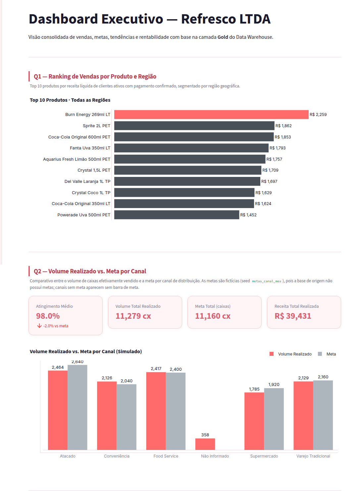
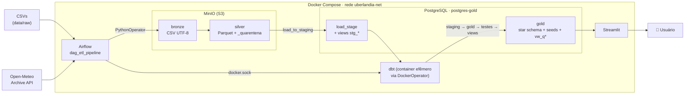

# 🚀 Refresco Data-Case: pipeline Medallion de vendas

Pipeline de dados **Bronze → Silver → Gold** que transforma arquivos de vendas, clientes, produtos e lançamentos financeiros de uma distribuidora de bebidas do Triângulo Mineiro, mais o clima diário de Uberlândia, em um **data warehouse dimensional** com regras de negócio versionadas, testes de qualidade e um dashboard analítico.

**Stack:** Docker Compose · Apache Airflow 2.9 · Python 3.12 / pandas · MinIO (S3) · PostgreSQL 15 · dbt-core 1.8 · Streamlit

---

## 📑 Sumário

1. [A aplicação rodando](#-a-aplicação-rodando)
2. [Arquitetura](#-arquitetura)
3. [Modelo de dados](#-modelo-de-dados)
4. [Regras de negócio](#-regras-de-negócio)
5. [Qualidade de dados](#-qualidade-de-dados)
6. [Como executar](#-como-executar)
7. [Estrutura do repositório](#-estrutura-do-repositório)
8. [Limitações conhecidas](#-limitações-conhecidas)
9. [Roadmap](#-roadmap)

---

## 📸 A aplicação rodando

Capturas da validação final da Sprint 1, em um ambiente recriado do zero (`docker compose down -v`).

**Airflow: DAG `dag_etl_pipeline` com as 14 tasks concluídas.** Bronze e Silver rodam com `PythonOperator`; o dbt roda em containers efêmeros via `DockerOperator`.


**Dashboard Streamlit: Q1 (ranking por região) e Q2 (volume vs. meta por canal; metas fictícias).**



**Dashboard Streamlit: Q3 (tendência com média móvel de 7 dias) e Q4 (margem bruta por SKU).**


> Na Q4, `Del Valle Pêssego` e `Burn Energy` aparecem com margem de 100% porque a origem traz `custo_unitario = 0.00`. O problema foi identificado na validação e está no backlog (card DQ-09).

---

## 🏗️ Arquitetura



| Camada | Responsabilidade |
|---|---|
| **Bronze** | Cópia fiel da origem no MinIO, lida com o encoding declarado de cada fonte e gravada em UTF-8, com metadados de linhagem (`_ingested_at`, `_source_file`). |
| **Silver** | Tipagem, nulos tratados, padronização de domínios, deduplicação determinística e validação. Registros rejeitados vão para `silver/_quarentena/` com o motivo. |
| **Gold** | dbt: views `stg_*`, star schema, seeds de regras de negócio, 65 testes de dados e 4 views analíticas. |

Detalhes de componentes, DAG e modelo: **[docs/arquitetura_dados.md](docs/arquitetura_dados.md)**.

---

## 📊 Modelo de dados

Star schema no schema `gold`:

| Tabela | Grão | Destaques |
|---|---|---|
| `fato_vendas` | 1 linha por venda | medidas (`qtd_caixas`, `receita_liquida`, `custo_total`, `margem_bruta`), status e tipo do lançamento, flags `entra_receita`/`entra_volume`; incremental por `id_venda` |
| `dim_cliente` | 1 por cliente | SCD1; canal ausente → `Não informado` |
| `dim_produto` | 1 por produto | família, marca, embalagem, preço e custo |
| `dim_representante` | 1 por (representante, canal) | derivada das vendas |
| `dim_tempo` | 1 por dia (2020–2030) | calendário PT-BR, dia útil, **clima diário** e agregados mensais |
| `regra_tipo_lancamento` *(seed)* | 1 por tipo | regra de receita e volume |
| `metas_canal_mes` *(seed)* | canal × mês | metas **fictícias** |

O diagrama ER completo está em [docs/arquitetura_dados.md](docs/arquitetura_dados.md#4-modelo-dimensional-schema-gold).

**Views analíticas** (consumidas pelo dashboard): `vw_q1_ranking_vendas` (top 10 produtos por região), `vw_q2_volume_vs_meta`, `vw_q3_tendencia_volume` (média móvel de 7 dias) e `vw_q4_margem_bruta`.

---

## 📐 Regras de negócio

Cada venda tem no máximo um lançamento financeiro, então o **tipo do lançamento classifica a venda**. A regra fica no seed `dbt/seeds/regra_tipo_lancamento.csv` e as views usam as flags, sem listar tipos em SQL:

| Tipo | Receita | Volume | Por quê |
|---|:---:|:---:|---|
| VENDA | ✅ | ✅ | Venda faturada |
| BONIFICACAO | ❌ | ✅ | Entregue sem cobrança: entra em volume e custo, não em receita |
| DEVOLUCAO | ❌ | ❌ | Venda desfeita |
| AJUSTE / OUTRO | ❌ | ❌ | Sem operação comercial |

- Todas as views consideram apenas `status_financeiro = 'PAGO'`.
- **Margem bruta** = receita de VENDA − custo de VENDA e BONIFICACAO.
- **Metas (Q2):** ⚠️ os valores de `dbt/seeds/metas_canal_mes.csv` são **fictícios**, porque a base de origem não possui metas. Eles são fixos e independentes do realizado. Uma meta calculada a partir do próprio realizado tornaria o atingimento circular.

Justificativas completas, no formato ADR: **[docs/decisoes_tratamento.md](docs/decisoes_tratamento.md)**.

---

## 🛡️ Qualidade de dados

**Princípio: nada é descartado em silêncio.** Todo registro rejeitado vai para a quarentena com o motivo legível.

| Entidade | Regras na Silver | Quarentena |
|---|---|---|
| Clientes | `id_cliente` no padrão `C9999`; `cnpj` e nome obrigatórios; 1 registro por `id_cliente`; CNPJ duplicado mantém o menor id | `silver/_quarentena/clientes/` |
| Vendas | `id_venda` obrigatório; data válida (4 formatos aceitos); `qtd_caixas > 0`; `preco_unitario > 0`; `0 ≤ desconto_pct < 1`; cliente e produto existentes no cadastro | `silver/_quarentena/vendas/` |
| Produtos | `id_produto` no padrão `P999` | apenas log (quarentena genérica no backlog, card ARQ-05) |
| Financeiro | tipos e status mapeados para domínios fixos | — |

Na última execução de referência, **3.482 vendas** chegaram à fato. A quarentena ficou com 18 vendas (6 com quantidade negativa, 3 com desconto ≥ 100%, 5 sem cliente e 4 com produto inválido) e 5 recadastros de clientes.

**Testes dbt (65):**
- Unicidade e `not_null` de chaves.
- `relationships` da fato com as dimensões e com o seed de regras: um tipo de lançamento novo sem regra quebra o build.
- Faixas de medidas em `stg_vendas`, como defesa em profundidade.
- Testes dos seeds.
- Teste singular `assert_clima_cobre_dias_com_venda`.

---

## 🚀 Como executar

**Pré-requisitos:** Docker e Docker Compose v2, Linux ou macOS (usa `/var/run/docker.sock`).

```bash
# 1. Configuração
cp .env.example .env
#    Preencha todos os valores <...> do .env:
#    - senhas (MinIO exige 8+ caracteres) e AIRFLOW_FERNET_KEY:
#        python -c "from cryptography.fernet import Fernet; print(Fernet.generate_key().decode())"
#    - DOCKER_GID:            stat -c '%g' /var/run/docker.sock
#    - DBT_PROJECT_HOST_PATH: caminho ABSOLUTO da pasta dbt/ deste repositório

# 2. Build e subida (o airflow-init migra o banco e cria o usuário admin)
docker compose up -d --build

# 3. Rodar o pipeline
#    Airflow: http://localhost:8080 (AIRFLOW_ADMIN_USER / AIRFLOW_ADMIN_PASSWORD)
#    Ative e dispare a DAG `dag_etl_pipeline`
```

| Serviço | URL |
|---|---|
| Airflow | http://localhost:8080 |
| Dashboard Streamlit | http://localhost:8501 (disponível após a primeira execução da DAG) |
| MinIO Console | http://localhost:9001 |
| pgAdmin | http://localhost:5050 |
| PostgreSQL Gold | `localhost:5432` (banco `POSTGRES_DB`) |

> **Atualizando um ambiente antigo.** Se você já tinha o ambiente rodando antes da Sprint 1, as credenciais e o volume do MinIO mudaram. Recrie os volumes com `docker compose down -v`. Isso apaga os dados locais, que se recriam rodando a DAG. Se preferir manter os volumes, a `fato_vendas` (incremental) ganhou colunas e precisa de um `dbt run --full-refresh --select fato_vendas`.

---

## 📁 Estrutura do repositório

```
refresco-data-case/
├── dags/etl_pipeline.py          # DAG do Airflow (Python + DockerOperator para o dbt)
├── pipeline/
│   ├── settings.py               # Configuração e credenciais via ambiente
│   ├── bronze/                   # ingest_csv.py, ingest_clima.py
│   ├── silver/                   # clean_*.py, text.py (validação, dedup, quarentena)
│   └── load/staging.py           # Silver → load_stage (PostgreSQL)
├── dbt/
│   ├── models/staging/           # Views stg_* (cast e renomeação) + testes
│   ├── models/marts/gold/        # dim_*, fato_vendas + testes
│   ├── models/marts/analytics/   # vw_q1..vw_q4
│   ├── seeds/                    # regra_tipo_lancamento, metas_canal_mes (fictícias)
│   ├── tests/                    # Testes singulares
│   └── macros/                   # generate_schema_name
├── streamlit/                    # Dashboard (imagem própria)
├── data/raw/                     # CSVs de origem
├── notebooks/exploration/        # Exploração e prototipação da limpeza
├── docs/
│   ├── arquitetura_dados.md      # Componentes, DAG, ER e testes
│   ├── decisoes_tratamento.md    # ADRs das decisões de dados
│   ├── diagnostico_orfaos_silver.md  # Diagnóstico histórico (resolvido)
│   ├── backlog/SPRINT-01.md      # Plano e resultados da Sprint 1
│   └── sql/                      # Consultas exploratórias (legado, fora do pipeline)
├── BACKLOG.md                    # Quadro Kanban de melhorias
├── docker-compose.yml
├── Dockerfile                    # Airflow 2.9.0 / Python 3.12 + constraints oficial
├── requirements.txt              # Runtime da imagem do Airflow (versões fixas)
├── requirements-dev.txt          # Testes e notebooks
└── .env.example
```

---

## ⚠️ Limitações conhecidas

Limitações assumidas conscientemente, com o card correspondente no [BACKLOG](BACKLOG.md):

| Limitação | Impacto | Card |
|---|---|---|
| Cada execução reprocessa toda a Bronze (partição por timestamp, sem `logical_date`) | O custo cresce a cada execução; sem backfill | ARQ-01 |
| A Silver é sobrescrita com `rm` + `write`, sem atomicidade | Uma falha no meio deixa a Silver parcial | ARQ-02 |
| A carga usa `DROP TABLE ... CASCADE` e tipos inferidos pelo pandas | Força recriar as views `stg_*` a cada execução | ARQ-03 |
| O incremental da fato filtra por `data_emissao` | Status financeiro atualizado depois não é reprocessado | MOD-01 |
| Sem testes unitários Python e sem CI | Validação manual e pelos testes dbt | ENG-02, ENG-03 |
| Execuções simultâneas corromperiam a Silver (`rm` + escrita) | Mitigado com `max_active_runs=1`; a correção estrutural é a escrita atômica | ARQ-01, ARQ-02 |
| `custo_unitario = 0` na origem para 2 produtos, sem validação | Margem de 100% na Q4 para esses SKUs | DQ-09 |
| As metas são fictícias e os dados são sintéticos, com tipos de lançamento uniformes | Números ilustrativos, não comerciais | — |
| Clima de uma única coordenada (Uberlândia) para 4 mesorregiões | Correlação clima × vendas aproximada | backlog |
| `docker.sock` montado no Airflow | Equivale a acesso root no host; aceitável só em ambiente local | — |
| `bitnamilegacy/minio` é uma imagem congelada (a `minio/minio` deixou de ser pública) | Sem atualizações de segurança | — |

---

## 🗺️ Roadmap

| Sprint | Foco | Status |
|---|---|---|
| **1** | Qualidade de dados, regras de negócio, reprodutibilidade e documentação | ✅ Concluída em 24/11/2026 ([plano e resultados](docs/backlog/SPRINT-01.md)) |
| **2** | Fundação de engenharia: módulo comum, testes unitários, CI de ponta a ponta, contratos dbt | 🟡 Plano aguardando aprovação ([plano](docs/backlog/SPRINT-02.md)) |
| **3** | Pipeline robusto: idempotência por `logical_date`, escrita atômica, carga tipada, incremental com merge, auditoria | Backlog |
| **4** | Modelagem e observabilidade: fato financeira, SCD2, representantes, alertas, freshness | Backlog |
| Opcionais | Cosmos, API FastAPI, Delta Lake, clima por região | Conforme o foco do portfólio |

Cards e critérios de aceite: [BACKLOG.md](BACKLOG.md).
