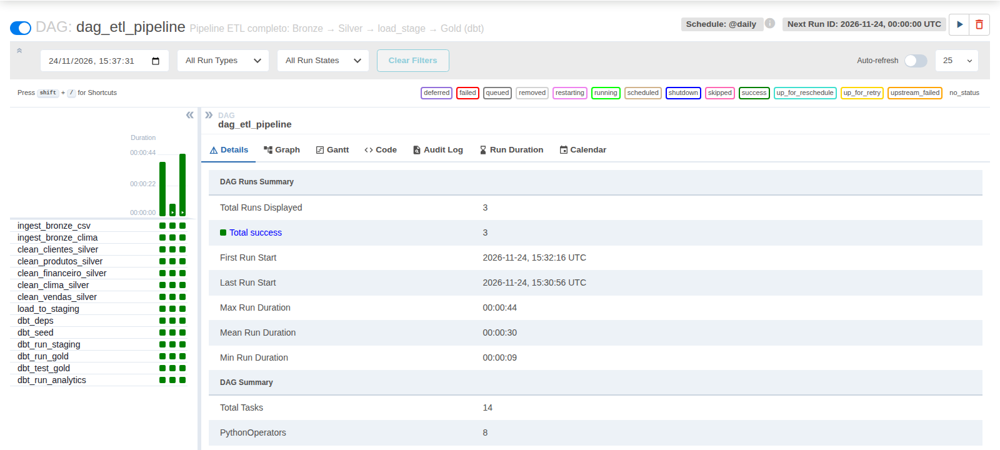
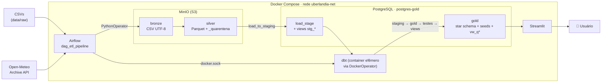

# 🚀 Refresco Data-Case: pipeline Medallion de vendas

[](https://github.com/rafaelladuarte/refresco-data-case/actions/workflows/ci.yml)

Pipeline de dados **Bronze → Silver → Gold** que transforma arquivos de vendas, clientes, produtos e lançamentos financeiros de uma distribuidora de bebidas do Triângulo Mineiro, mais o clima diário de Uberlândia, em um **data warehouse dimensional** com regras de negócio versionadas, testes de qualidade e um dashboard analítico.

**Stack:** Docker Compose · Apache Airflow 2.9 · Python 3.12 / pandas · MinIO (S3) · PostgreSQL 15 · dbt-core 1.8 · Streamlit

---

## 📑 Sumário

1. [A aplicação rodando](#-a-aplicação-rodando)
2. [Arquitetura](#-arquitetura)
3. [Modelo de dados](#-modelo-de-dados)
4. [Regras de negócio](#-regras-de-negócio)
5. [Qualidade de dados](#-qualidade-de-dados)
6. [Como executar](#-como-executar)
7. [Como rodar os testes](#-como-rodar-os-testes)
8. [Estrutura do repositório](#-estrutura-do-repositório)
9. [Limitações conhecidas](#-limitações-conhecidas)
10. [Melhorias futuras](#-melhorias-futuras)

---

## 📸 A aplicação rodando

Capturas da aplicação em um ambiente recriado do zero (`docker compose down -v`).

**Airflow: DAG `dag_etl_pipeline` com todas as tasks concluídas** (a captura é de uma versão anterior, com a task extra `dbt_run_staging`; hoje as views `stg_*` são recriadas dentro da `dbt_run_gold`, e a DAG tem 13 tasks). Bronze e Silver rodam com `PythonOperator`; o dbt roda em containers efêmeros via `DockerOperator`.




**Dashboard Streamlit: Q1 (ranking por região) e Q2 (volume vs. meta por canal; metas fictícias).**


**Dashboard Streamlit: Q3 (tendência com média móvel de 7 dias) e Q4 (margem bruta por SKU).**


> Na Q4, `Del Valle Pêssego` e `Burn Energy` aparecem como **custo indisponível**: a origem traz `custo_unitario = 0.00`. Eles continuam contando em receita e volume, mas ficam fora do ranking e do gráfico de margem (DQ-09).

---

## 🏗️ Arquitetura



| Camada | Responsabilidade |
|---|---|
| **Bronze** | Cópia fiel da origem no MinIO, lida com o encoding declarado de cada fonte e gravada em UTF-8, particionada pela **data lógica** da execução (`ingestion_date=YYYY-MM-DD`), com metadados de linhagem (`_ingested_at`, `_logical_date`, `_source_file`). Reexecutar a data sobrescreve a mesma partição. |
| **Silver** | Tipagem, nulos tratados, padronização de domínios, deduplicação determinística e validação. Processa só a partição da data e faz *merge* com o estado atual (precedência pela data lógica), com escrita atômica. Registros rejeitados vão para `silver/_quarentena/<entidade>/<data>`, e cada task grava sua linha em `audit.dq_results`. |
| **Load** | `load_stage` no Postgres, com DDL tipada versionada e carga por `TRUNCATE` + `COPY` numa única transação: as views `stg_*` sobrevivem à carga. |
| **Gold** | dbt: views `stg_*` (onde as métricas são calculadas), star schema, seeds de regras de negócio, 78 testes de dados e 4 views analíticas. A `fato_vendas` é incremental por mudança (`merge`). |

Detalhes de componentes, DAG e modelo: **[docs/arquitetura_dados.md](docs/arquitetura_dados.md)**.

---

## 📊 Modelo de dados

Star schema no schema `gold`:

| Tabela | Grão | Destaques |
|---|---|---|
| `fato_vendas` | 1 linha por venda | medidas (`qtd_caixas`, `receita_liquida`, `custo_total`, `margem_bruta`), status e tipo do lançamento, flags `entra_receita`/`entra_volume`; incremental por mudança (`merge` por `id_venda`) |
| `dim_cliente` | 1 por cliente | SCD1; canal ausente → `Não informado` |
| `dim_produto` | 1 por produto | família, marca, embalagem, preço e custo |
| `dim_representante` | 1 por (representante, canal) | derivada das vendas |
| `dim_tempo` | 1 por dia (2020–2030) | calendário PT-BR, dia útil, **clima diário** e agregados mensais |
| `regra_tipo_lancamento` *(seed)* | 1 por tipo | regra de receita e volume |
| `metas_canal_mes` *(seed)* | canal × mês | metas **fictícias** |

O diagrama ER completo está em [docs/arquitetura_dados.md](docs/arquitetura_dados.md#4-modelo-dimensional-schema-gold).

**Views analíticas** (consumidas pelo dashboard): `vw_q1_ranking_vendas` (top 10 produtos por região), `vw_q2_volume_vs_meta`, `vw_q3_tendencia_volume` (média móvel de 7 dias) e `vw_q4_margem_bruta`.

---

## 📐 Regras de negócio

Cada venda tem no máximo um lançamento financeiro, então o **tipo do lançamento classifica a venda**. A regra fica no seed `dbt/seeds/regra_tipo_lancamento.csv` e as views usam as flags, sem listar tipos em SQL:

| Tipo | Receita | Volume | Por quê |
|---|:---:|:---:|---|
| VENDA | ✅ | ✅ | Venda faturada |
| BONIFICACAO | ❌ | ✅ | Entregue sem cobrança: entra em volume e custo, não em receita |
| DEVOLUCAO | ❌ | ❌ | Venda desfeita |
| AJUSTE / OUTRO | ❌ | ❌ | Sem operação comercial |

- Todas as views consideram apenas `status_financeiro = 'PAGO'`.
- **Margem bruta** = receita de VENDA − custo de VENDA e BONIFICACAO.
- **Metas (Q2):** ⚠️ os valores de `dbt/seeds/metas_canal_mes.csv` são **fictícios**, porque a base de origem não possui metas. Eles são fixos e independentes do realizado. Uma meta calculada a partir do próprio realizado tornaria o atingimento circular.

Justificativas completas, no formato ADR: **[docs/decisoes_tratamento.md](docs/decisoes_tratamento.md)**.

---

## 🛡️ Qualidade de dados

**Princípio: nada é descartado em silêncio.** Todo registro rejeitado vai para a quarentena com o motivo legível.

| Entidade | Regras na Silver | Quarentena |
|---|---|---|
| Clientes | `id_cliente` no padrão `C9999`; `cnpj` e nome obrigatórios; 1 registro por `id_cliente`; CNPJ duplicado mantém o menor id | `silver/_quarentena/clientes/<data>` |
| Vendas | `id_venda` obrigatório; data válida (4 formatos aceitos); `qtd_caixas > 0`; `preco_unitario > 0`; `0 ≤ desconto_pct < 1`; cliente e produto existentes no cadastro | `silver/_quarentena/vendas/<data>` |
| Produtos | `id_produto` no padrão `P999`; `custo_unitario`/`preco_tabela` `<= 0` ou ausente vira NULL com flag `custo_disponivel`/`preco_disponivel = false` (o produto é mantido e fica fora da margem) | `silver/_quarentena/produtos/<data>` |
| Financeiro | `id_financeiro` obrigatório; competência válida (`YYYYMM` ou `YYYY/MM`); tipos e status mapeados para domínios fixos | `silver/_quarentena/financeiro/<data>` |
| Clima | data (`time`) válida | `silver/_quarentena/clima/<data>` |

Na última execução de referência, **3.482 vendas** chegaram à fato. A quarentena ficou com 18 vendas (6 com quantidade negativa, 3 com desconto ≥ 100%, 5 sem cliente e 4 com produto inválido), 5 recadastros de clientes e 10 lançamentos financeiros com competência inválida (que antes eram descartados em silêncio). Além disso, 8 vendas repetidas na origem foram deduplicadas (vale a mais recente).

**Testes dbt (78):**
- Unicidade e `not_null` de chaves.
- Coerência entre flag e valor em `dim_produto`: custo disponível é sempre `> 0`, e indisponível é sempre NULL (idem para preço).
- `relationships` da fato com as dimensões e com o seed de regras: um tipo de lançamento novo sem regra quebra o build.
- Faixas de medidas em `stg_vendas`, como defesa em profundidade.
- Testes dos seeds.
- `accepted_values` em canal, UF, região e família.
- Teste singular `assert_clima_cobre_dias_com_venda`.
- Teste singular `assert_fato_reconcilia_com_staging`: a fato tem a mesma contagem e a mesma soma de `receita_liquida` que `stg_vendas`.

---

## 🚀 Como executar

**Pré-requisitos:** Docker e Docker Compose v2, Linux ou macOS (usa `/var/run/docker.sock`).

```bash
# 1. Configuração
cp .env.example .env
#    Preencha todos os valores <...> do .env:
#    - senhas (MinIO exige 8+ caracteres) e AIRFLOW_FERNET_KEY:
#        python -c "from cryptography.fernet import Fernet; print(Fernet.generate_key().decode())"
#    - DOCKER_GID:            stat -c '%g' /var/run/docker.sock
#    - HOST_UID / HOST_GID:   id -u / id -g  (dono dos arquivos que o dbt grava em dbt/)
#    - DBT_PROJECT_HOST_PATH: caminho ABSOLUTO da pasta dbt/ deste repositório

# 2. Build e subida (o airflow-init migra o banco e cria o usuário admin)
docker compose up -d --build

# 3. Rodar o pipeline
#    Airflow: http://localhost:8080 (AIRFLOW_ADMIN_USER / AIRFLOW_ADMIN_PASSWORD)
#    Ative e dispare a DAG `dag_etl_pipeline`
```

| Serviço | URL |
|---|---|
| Airflow | http://localhost:8080 |
| Dashboard Streamlit | http://localhost:8501 (disponível após a primeira execução da DAG) |
| MinIO Console | http://localhost:9001 |
| pgAdmin | http://localhost:5050 |
| PostgreSQL Gold | `localhost:5432` (banco `POSTGRES_DB`) |

> **Arquivos do dbt com dono root.** Versões anteriores rodavam o dbt como root, e `dbt/target`, `dbt/logs`, `dbt/dbt_packages` e `dbt/package-lock.yml` podem ter ficado com dono `root`. Para corrigir uma única vez:
> `docker run --rm -v "$PWD/dbt:/w" alpine:3.20 sh -c "chown -R $(id -u):$(id -g) /w"`

> **Atualizando um ambiente existente (custo indisponível).** A partir do DQ-09, P012/P019 têm `custo_total`/`margem_bruta` NULL na `fato_vendas`. Como ela é incremental, as vendas antigas só são recalculadas com `dbt run --full-refresh --select fato_vendas+` (uma vez, depois de rodar a DAG; o `+` recria as views analíticas, que o full-refresh derruba em cascata).

> **Atualizando um ambiente existente (partições Bronze por data).** A partir do ARQ-01 a Bronze é particionada pela data lógica da execução (`ingestion_date=YYYY-MM-DD`), e a Silver processa só a partição da data. As partições antigas, com horário (`ingestion_date=2026-11-25T12:17:55`), são **ignoradas** com um warning. Para removê-las uma única vez (lista primeiro, e só apaga com `--apply`):
> `python scripts/cleanup_legacy_bronze.py` e depois `python scripts/cleanup_legacy_bronze.py --apply` (com as variáveis do `.env` exportadas), ou `docker compose down -v` num ambiente de teste. A Silver gravada antes desta mudança é aceita: as colunas de controle são completadas no primeiro merge.

> **Atualizando um ambiente existente (tabelas de `load_stage`).** A carga agora usa tipos explícitos (`pipeline/ddl/load_stage.sql`) e `TRUNCATE` + `COPY`. Na **primeira** execução depois da atualização, as tabelas de `load_stage` criadas pelo pandas (colunas e tipos diferentes da DDL, como `ano` em `text`) são recriadas, com um aviso, e as views `stg_*` dependentes caem; a `dbt_run_gold` as recria na mesma execução. Daí em diante as views sobrevivem às cargas.

> **Atualizando um ambiente antigo.** Se você já tinha o ambiente rodando antes de as credenciais passarem a vir do `.env`, as credenciais e o volume do MinIO mudaram. Recrie os volumes com `docker compose down -v`. Isso apaga os dados locais, que se recriam rodando a DAG. Se preferir manter os volumes, a `fato_vendas` (incremental) ganhou colunas e precisa de um `dbt run --full-refresh --select fato_vendas+`.

### Reprocessamento e backfill

Cada execução da DAG tem uma **data lógica** (`{{ ds }}`). Bronze e Silver trabalham só com a partição dessa data:

- **Bronze:** grava `bronze/<tabela>/ingestion_date=<ds>/`. Reexecutar a mesma data sobrescreve o mesmo objeto.
- **Silver:** lê a partição da data, valida e faz *merge* com o estado atual por chave natural. Quem vence é a versão de **maior data lógica** (depois, a ingerida por último), então um backfill de uma data antiga nunca desfaz uma data mais nova, mesmo rodando depois. Reexecutar uma data dá o mesmo resultado.
- **Colunas de controle** em toda tabela Silver: `_logical_date`, `_ingested_at`, `_row_hash` (hash do conteúdo de negócio) e `_changed_at` (só avança quando o conteúdo da linha muda).

```bash
# Reprocessar uma data (a DAG tem catchup=False; backfill é explícito)
docker compose exec airflow-scheduler airflow dags backfill dag_etl_pipeline \
  --start-date 2026-11-20 --end-date 2026-11-22

# Uma tarefa avulsa, fora do Airflow, para uma data
python -m pipeline.silver.clean_vendas 2026-11-20
```

### Incremental da `fato_vendas` e lookback

A fato é incremental por **mudança**, não por data. Uma venda é reprocessada (`merge` por `id_venda`) quando:

1. a venda **ou o lançamento financeiro dela** mudou depois da última carga (`atualizado_em`, que vem do `_changed_at` da Silver). Isso cobre vendas retroativas, correções e a mudança de status de uma venda antiga;
2. ela foi emitida nos últimos `lookback_days` dias (variável do dbt, padrão **30**). Isso cobre mudanças nas **dimensões** (como o custo de um produto), que não alteram a venda e por isso não aparecem em `atualizado_em`.

```bash
# janela maior (ex.: depois de corrigir o custo de um produto com vendas antigas)
dbt run --select fato_vendas --vars '{lookback_days: 365}'
# recálculo completo; o `+` recria as views analíticas, que o full-refresh derruba em cascata
dbt run --full-refresh --select fato_vendas+
```

### Quarentena e auditoria

Todo registro rejeitado vai para `silver/_quarentena/<entidade>/<data lógica>` (Parquet, com a coluna `motivo_rejeicao`), para as cinco entidades. Reexecutar uma data substitui só a quarentena dela; as demais datas ficam como histórico.

Cada task Silver também grava em **`audit.dq_results`** (Postgres Gold) o que leu, aprovou, descartou por duplicidade e rejeitou, com uma linha por motivo:

```sql
select entidade, lidas, aprovadas, duplicadas, rejeitadas
from audit.dq_results
where run_id = '<run_id do Airflow>' and motivo is null;   -- resumo; sem o filtro, vem o detalhe por motivo
```

A fonte (`data/raw`) é um *snapshot* completo a cada execução, não uma sequência de deltas. Consequências assumidas: uma linha que **some** da origem permanece na Silver (o merge nunca apaga), e a unicidade de CNPJ entre clientes é aplicada dentro da partição da data, não entre datas.

---

## 🧪 Como rodar os testes

Os testes unitários rodam fora do Docker, em Python 3.12 (`.python-version`). As versões fixadas não têm wheels para o 3.13.

```bash
python -m venv .venv && source .venv/bin/activate   # com pyenv, o 3.12 é selecionado pelo .python-version
pip install -r requirements-dev.txt

pytest --cov                                    # testes + gate de 80% (pipeline/common e funções de regra)
coverage report --include='pipeline/*' --fail-under=0   # relatório completo, sem gate

ruff check . && ruff format --check .           # lint e formato (configuração no pyproject.toml)
```

- `tests/unit/`: funções puras (validação de vendas, dedup de clientes, datas, mapeamentos do financeiro, normalizações, configuração, storage e ingestão de clima com respostas HTTP simuladas). Não precisam de MinIO, Postgres nem rede.
- `tests/integration/test_dag.py`: integridade da DAG (importação, 13 tasks, dependências, `max_active_runs=1`). Precisa do Airflow, então é pulado no virtualenv. Dentro da imagem:

```bash
docker run --rm --entrypoint bash -v "$PWD:/opt/airflow/repo:ro" -w /opt/airflow/repo refresco-data-case-airflow-init \
  -c 'pip install -q --target /tmp/pt pytest==8.3.4 && PYTHONPATH=/tmp/pt python -m pytest tests/integration -p no:cacheprovider'
```

As funções `main()`, que só fazem entrada e saída (S3/Postgres), ficam fora do gate e são cobertas pela execução de ponta a ponta.

### Teste ponta a ponta (`scripts/e2e.sh`)

Roda o pipeline inteiro (Bronze → Silver → `load_stage` → `dbt deps/seed/build`) sobre `data/raw` e compara o resultado com os números de referência (3.482 vendas na fato, 18 e 5 registros nas quarentenas de vendas e clientes, receita total e Q4 sem margem para produtos sem custo). Também confere a auditoria (`audit.dq_results`) e a escrita atômica contra o MinIO real, com falhas injetadas. No fim, roda o teste de integridade da DAG na imagem do Airflow.

```bash
scripts/e2e.sh                       # sobe MinIO e Postgres descartáveis (portas 19000 e 15432) e os remove ao terminar
E2E_DAG_TEST=0 scripts/e2e.sh        # pula o build da imagem do Airflow (mais rápido)
```

Depois do dia 1 ele compara o conteúdo de 31 datasets (Silver, quarentenas, `load_stage` e `gold`) com o baseline versionado em `tests/baseline/fingerprint.json`, o que prova que uma refatoração não mudou dados. Se a mudança de dados for intencional, regrave o baseline com `E2E_UPDATE_BASELINE=1` e justifique no commit. Em seguida roda um **dia 2** (outra data lógica): uma cópia de `data/raw` com quatro mudanças conhecidas (status financeiro de uma venda antiga, venda retroativa, nome de cliente e custo de um produto), conferindo que só elas aparecem, sem `--full-refresh`. Por fim reexecuta o dia 2 (idempotência) e o dia 1 depois do dia 2 (backfill fora de ordem), e exige que o estado fique idêntico.

O script não lê o `.env` nem toca no ambiente de desenvolvimento. O clima vem de respostas gravadas da Open-Meteo em `tests/fixtures/open_meteo/` (variável `CLIMA_FIXTURE_DIR`), então o teste não depende da API.

### CI (GitHub Actions)

`.github/workflows/ci.yml` roda em todo `push` e `pull_request`, com dois jobs:

| Job | O que faz |
|---|---|
| `lint-unit` | `ruff check`, `ruff format --check` e `pytest tests/unit` com o gate de cobertura |
| `e2e` | MinIO e Postgres como *service containers* e `scripts/e2e.sh` |

---

## 📁 Estrutura do repositório

```
refresco-data-case/
├── dags/etl_pipeline.py          # DAG do Airflow (Python + DockerOperator para o dbt)
├── pipeline/
│   ├── common/                   # config, storage (S3, escrita atômica, quarentena), merge, audit, validators, logging
│   ├── bronze/                   # ingest_csv.py, ingest_clima.py (partição por data lógica)
│   ├── silver/                   # clean_*.py (regras de validação, dedup, merge, quarentena, auditoria)
│   ├── load/staging.py           # Silver → load_stage (TRUNCATE + COPY numa transação)
│   └── ddl/                      # load_stage.sql (tabelas tipadas) e audit.sql (audit.dq_results)
├── dbt/
│   ├── models/staging/           # Views stg_* (cast e renomeação) + testes
│   ├── models/marts/gold/        # dim_*, fato_vendas + testes
│   ├── models/marts/analytics/   # vw_q1..vw_q4
│   ├── seeds/                    # regra_tipo_lancamento, metas_canal_mes (fictícias)
│   ├── tests/                    # Testes singulares
│   └── macros/                   # generate_schema_name
├── streamlit/                    # Dashboard (imagem própria)
├── data/raw/                     # CSVs de origem
├── tests/                        # unit/ (pytest, sem infraestrutura), integration/ (DAG), fixtures/ (clima gravado) e baseline/ (fingerprint)
├── scripts/                      # e2e.sh (ponta a ponta, usado pela CI), e2e_*.py (verificações), fingerprint.py, cleanup_legacy_bronze.py
├── .github/workflows/ci.yml      # CI: lint + unit e e2e
├── notebooks/exploration/        # Exploração e prototipação da limpeza
├── docs/
│   ├── arquitetura_dados.md      # Componentes, DAG, ER e testes
│   ├── decisoes_tratamento.md    # ADRs das decisões de dados
│   ├── diagnostico_orfaos_silver.md  # Diagnóstico histórico (resolvido)
│   ├── backlog/SPRINT-0*.md      # Planos e resultados das sprints
│   └── sql/                      # Consultas exploratórias (legado, fora do pipeline)
├── BACKLOG.md                    # Quadro Kanban de melhorias
├── docker-compose.yml
├── Dockerfile                    # Airflow 2.9.0 / Python 3.12 + constraints oficial
├── requirements.txt              # Runtime da imagem do Airflow (versões fixas)
├── requirements-dev.txt          # Testes e notebooks
├── pyproject.toml                # Configuração do pytest, da cobertura e do ruff
└── .env.example
```

---

## ⚠️ Limitações conhecidas

Limitações assumidas conscientemente, com o card correspondente no [BACKLOG](BACKLOG.md):

| Limitação | Impacto | Card |
|---|---|---|
| O merge da Silver nunca apaga: linha que some da origem permanece | Cadastro removido na fonte continua na Silver; CNPJ duplicado entre datas não é detectado | backlog |
| A troca da escrita atômica no S3 não é instantânea (o S3 não tem `rename`) | Janela de poucos segundos, com recuperação automática na próxima escrita | — |
| Colunas novas na Silver exigem atualizar `pipeline/ddl/load_stage.sql` (e o dbt) antes | A carga falha cedo, listando a diferença, em vez de aceitar um desvio de schema | — |
| Mudança em uma **dimensão** (ex.: custo de um produto) só chega às vendas emitidas dentro de `lookback_days` (30) | Vendas mais antigas ficam com o valor antigo até `--full-refresh` ou `--vars '{lookback_days: N}'` | — |
| Execuções simultâneas da DAG | Continua em `max_active_runs=1`; a escrita atômica protege a Silver de falhas, não de concorrência | — |
| As metas são fictícias e os dados são sintéticos, com tipos de lançamento uniformes | Números ilustrativos, não comerciais | — |
| Clima de uma única coordenada (Uberlândia) para 4 mesorregiões | Correlação clima × vendas aproximada | backlog |
| `docker.sock` montado no Airflow | Equivale a acesso root no host; aceitável só em ambiente local | — |
| `bitnamilegacy/minio` é uma imagem congelada (a `minio/minio` deixou de ser pública) | Sem atualizações de segurança | — |

---

## 🗺️ Melhorias futuras

O pipeline está completo e testado de ponta a ponta. Os pontos abaixo são evoluções conhecidas, que não bloqueiam o uso. Cards, critérios de aceite e complexidade: [BACKLOG.md](BACKLOG.md).

**Modelagem e observabilidade**

| Melhoria | Por quê |
|---|---|
| Revisar `dim_representante` | Hoje a dimensão é derivada de vendas por (nome, canal), então o mesmo representante aparece uma vez por canal e não se relaciona com `dim_cliente.representante`. A proposta é uma linha por representante, com o canal na fato. |
| Fato de lançamentos financeiros | Os valores financeiros (`valor_bruto`, `valor_imposto`, `valor_liquido`) são descartados na Silver, e o grão financeiro está misturado na fato de vendas. A proposta é uma `fato_lancamento_financeiro` com o grão do lançamento. |
| SCD Tipo 2 para clientes (dbt snapshots) | As dimensões são SCD1, então o histórico de canal e representante do cliente se perde. |
| Alertas e callbacks no Airflow | Notificar falhas de task. |
| Persistir resultados do dbt e *freshness* | Guardar o resultado dos testes e acompanhar a atualização dos dados. |
| Página de qualidade de dados no Streamlit | A `audit.dq_results` já guarda o que cada execução leu, aprovou e rejeitou; falta exibir. |
| Contratos de dados | Formalizar o esquema esperado entre as camadas. |

**Opcionais, conforme o foco**

| Melhoria | Por quê |
|---|---|
| Astronomer Cosmos | Uma task por modelo dbt no Airflow, com visibilidade e retry por modelo. |
| API FastAPI somente leitura sobre a Gold | Cobre a parte de backend; o Streamlit poderia consumi-la. |
| Delta Lake na Silver | Merge nativo e *time travel*, sem Spark (biblioteca `deltalake`). |
| Clima por região | Os clientes estão em 4 mesorregiões de MG, mas o clima vem de uma única coordenada (Uberlândia). |

Spark, Kafka e Kubernetes ficam fora de escopo de propósito: com ~3,5 mil linhas, seriam tecnologia sem justificativa.
