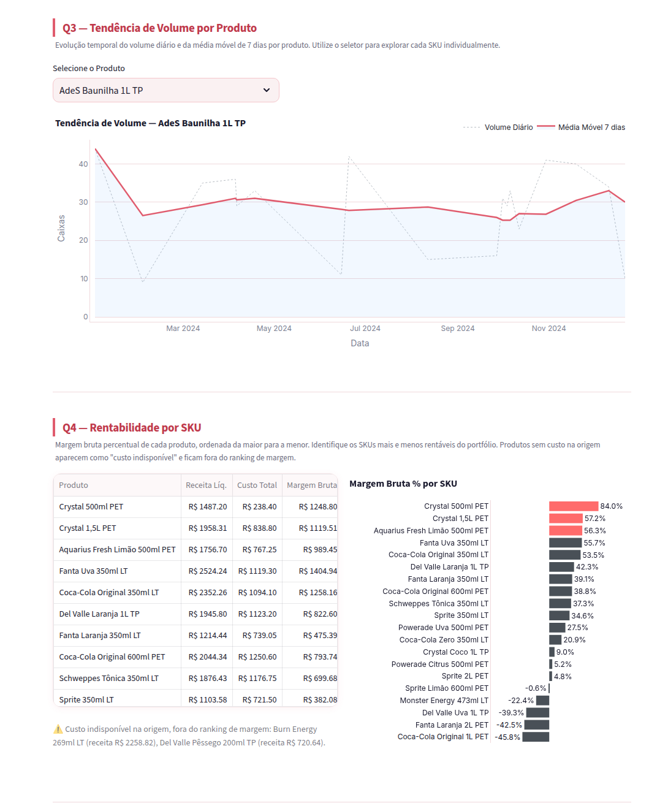
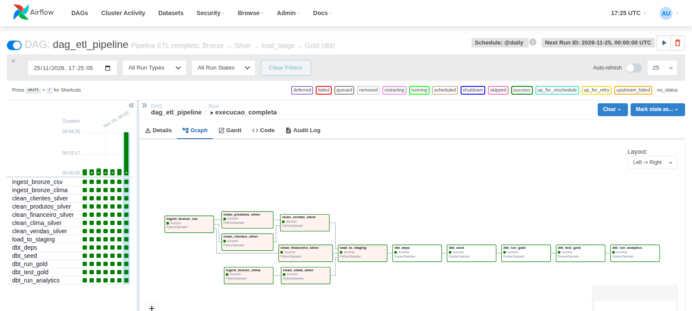
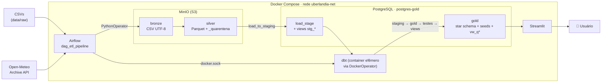
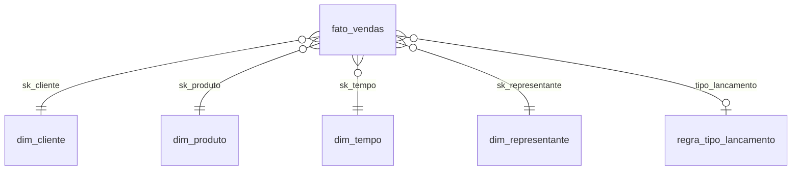

# 🥤 Refresco Data-Case

[](https://github.com/rafaelladuarte/refresco-data-case/actions/workflows/ci.yml)

Pipeline de dados **Bronze → Silver → Gold** para uma distribuidora de bebidas do Triângulo Mineiro: transforma vendas, clientes, produtos, financeiro e o clima de Uberlândia em um **data warehouse dimensional**, com regras de negócio versionadas, testes de qualidade e um dashboard.

`Airflow` · `Python / pandas` · `MinIO (S3)` · `PostgreSQL` · `dbt` · `Streamlit` · `Docker Compose`

| 🧪 Testes | 🛡️ Qualidade | 🔁 Reprocessamento | ✅ Validação |
|:---:|:---:|:---:|:---:|
| 299 unitários + e2e + CI | nada é descartado em silêncio | idempotente, com backfill | 31 datasets comparados a um baseline |

---

## 📸 A aplicação rodando


<details>
<summary>Mais capturas (Q3/Q4 e Airflow)</summary>





</details>

---

## 🏗️ Arquitetura



| Camada | O que faz |
|---|---|
| **Bronze** | Cópia fiel da origem, em UTF-8, particionada pela **data lógica** da execução. |
| **Silver** | Limpa, valida e faz *merge* com o estado atual. Escrita atômica. Rejeitados vão para a **quarentena** com o motivo, e cada task grava sua **auditoria**. |
| **Load** | `load_stage` com DDL tipada e `TRUNCATE` + `COPY` numa transação. |
| **Gold** | dbt: star schema, regras em seeds, 78 testes e 4 views analíticas. Fato incremental por mudança. |

Detalhes de componentes, DAG e modelo: [docs/arquitetura_dados.md](docs/arquitetura_dados.md).

---

## 🚀 Como executar

Pré-requisitos: Docker e Docker Compose v2 (Linux ou macOS).

```bash
cp .env.example .env       # preencha os valores (o arquivo explica cada um)
docker compose up -d --build
# abra o Airflow, ative e dispare a DAG `dag_etl_pipeline`
```

| Serviço | URL |
|---|---|
| Airflow | http://localhost:8080 |
| Dashboard | http://localhost:8501 (após a primeira execução) |
| MinIO | http://localhost:9001 |
| pgAdmin | http://localhost:5050 |

Reprocessar uma data: `airflow dags backfill dag_etl_pipeline --start-date 2026-11-20 --end-date 2026-11-22`.
Mais comandos e a atualização de ambientes antigos: **[docs/operacao.md](docs/operacao.md)**.

---

## 📊 Modelo de dados



| Tabela | Grão |
|---|---|
| `fato_vendas` | 1 por venda (`receita_liquida`, `custo_total`, `margem_bruta`, status e tipo do lançamento) |
| `dim_cliente` · `dim_produto` · `dim_representante` | 1 por cliente, produto e (representante, canal) |
| `dim_tempo` | 1 por dia, com calendário PT-BR e **clima diário** |
| `regra_tipo_lancamento` · `metas_canal_mes` | seeds (as metas são **fictícias**) |

Views para o dashboard: `vw_q1_ranking_vendas`, `vw_q2_volume_vs_meta`, `vw_q3_tendencia_volume`, `vw_q4_margem_bruta`.

---

## 📐 Regras de negócio

Cada venda tem no máximo um lançamento financeiro, então o **tipo do lançamento classifica a venda**. A regra mora em um seed, sem listar tipos em SQL:

| Tipo | Receita | Volume | Por quê |
|---|:---:|:---:|---|
| VENDA | ✅ | ✅ | Venda faturada |
| BONIFICACAO | ❌ | ✅ | Entregue sem cobrança: conta no volume e no custo |
| DEVOLUCAO | ❌ | ❌ | Venda desfeita |
| AJUSTE / OUTRO | ❌ | ❌ | Sem operação comercial |

Só entram vendas com `status = PAGO`. **Margem bruta** = receita de VENDA − custo de VENDA e BONIFICACAO. Produtos sem custo na origem ficam fora do ranking de margem. Justificativas: [docs/decisoes_tratamento.md](docs/decisoes_tratamento.md).

---

## 🛡️ Qualidade de dados

**Princípio: nada é descartado em silêncio.** Todo registro rejeitado vai para `silver/_quarentena/<entidade>/<data>` com o motivo, e `audit.dq_results` registra o que cada execução leu, aprovou, duplicou e rejeitou.

| Entidade | Lidas | Aprovadas | Duplicadas | Rejeitadas |
|---|--:|--:|--:|--:|
| Vendas | 3.508 | 3.482 | 8 | 18 |
| Clientes | 120 | 115 | 0 | 5 |
| Financeiro | 2.464 | 2.454 | 0 | 10 |
| Produtos | 25 | 25 | 0 | 0 |
| Clima | 2.192 | 2.192 | 0 | 0 |

Regras por entidade e os 78 testes dbt: [docs/operacao.md](docs/operacao.md#regras-de-qualidade).

---

## 🧪 Testes e CI

```bash
python -m venv .venv && source .venv/bin/activate
pip install -r requirements-dev.txt
pytest --cov                    # 299 testes + gate de cobertura
ruff check . && ruff format --check .
scripts/e2e.sh                  # pipeline inteiro, com MinIO e Postgres descartáveis
```

O **e2e** roda o pipeline em dois dias com dados alterados, reexecuta e faz backfill fora de ordem, e compara 31 datasets com um baseline versionado: se um refactor mudar um dado, ele reprova. A **CI** (GitHub Actions) roda lint, testes unitários e o e2e em todo push. Detalhes: [docs/operacao.md](docs/operacao.md#como-rodar-os-testes).

---

## 📁 Estrutura

```
dags/                 DAG do Airflow (13 tasks)
pipeline/             bronze/ · silver/ · load/ · common/ · ddl/
dbt/                  models (staging, gold, analytics) · seeds · tests
streamlit/            dashboard
tests/                unit · integration · fixtures · baseline
scripts/              e2e.sh e verificações
docs/                 arquitetura, decisões, operação, planos das sprints
```

---

## ⚠️ Limitações conhecidas

- Os **dados são sintéticos** e as **metas são fictícias**: os números são ilustrativos.
- O *merge* da Silver nunca apaga: uma linha que some da origem permanece. A unicidade de CNPJ vale dentro de cada data.
- Mudança em uma **dimensão** (ex.: custo de produto) só chega às vendas dos últimos `lookback_days` (30); use `--vars '{lookback_days: N}'` ou `--full-refresh`.
- O clima vem de **uma só coordenada** (Uberlândia) para 4 mesorregiões.
- `docker.sock` montado no Airflow (acesso equivalente a root): aceitável só em ambiente local.
- `bitnamilegacy/minio` é uma imagem congelada, sem atualizações de segurança.

---

## 🗺️ Melhorias futuras

O pipeline está completo; estes pontos são evoluções ([BACKLOG.md](BACKLOG.md)):

| Modelagem | Observabilidade | Opcionais |
|---|---|---|
| `dim_representante` com 1 linha por representante | Alertas e callbacks no Airflow | Cosmos (uma task por modelo dbt) |
| Fato de lançamentos financeiros | Resultados do dbt e *freshness* | API FastAPI sobre a Gold |
| SCD Tipo 2 para clientes | Página de qualidade no Streamlit | Delta Lake na Silver |
| Contratos de dados | | Clima por região |
