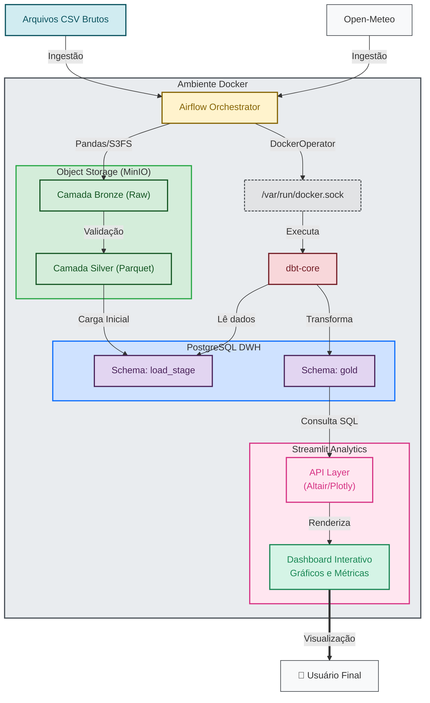
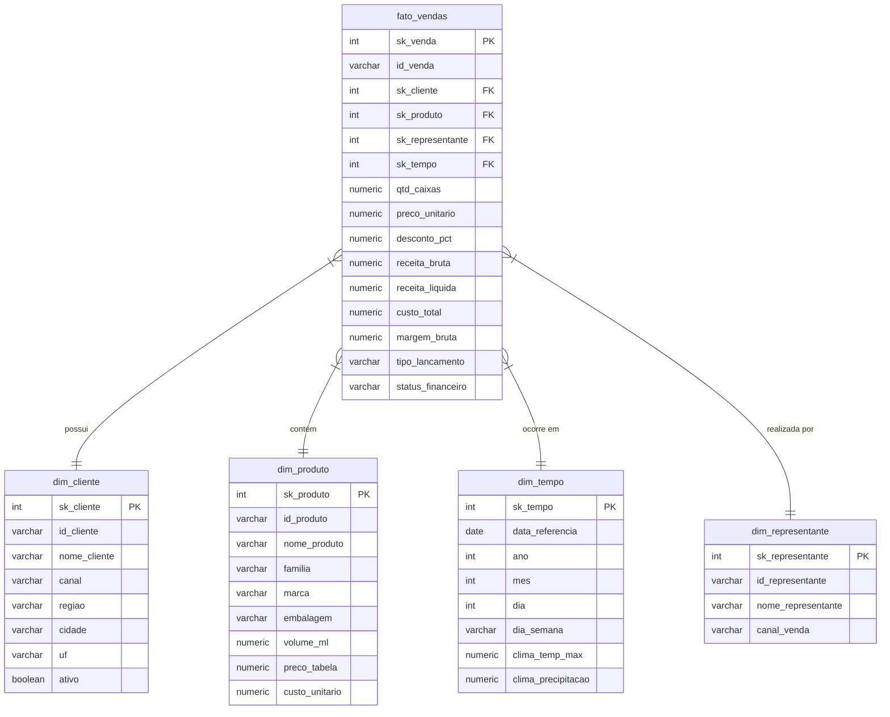

# 🚀 Refresco Data‑Case – Pipeline ETL Medallion

> Projeto de demonstração de um pipeline **Medallion Architecture** (Bronze → Silver → Gold) construído com **Docker**, **Airflow**, **Python (pandas)** e **dbt‑core**.  
> O objetivo é transformar arquivos CSV brutos de vendas, clientes, produtos, clima e finanças em um data‑warehouse dimensional pronto para análises de negócio.

---

## 📑 Sumário

1. [Visão Geral](#visão-geral)  
2. [Arquitetura de Dados (Diagrama)](#arquitetura-de-dados)  
3. [Modelagem Dimensional (Star Schema)](#modelagem-dimensional)  
4. [Qualidade e Integridade de Dados](#qualidade-de-dados)  
5. [Tecnologias & Justificativas](#tecnologias)  
6. [Como Executar](#como-executar)  
7. [Estrutura de Diretórios](#estrutura-de-pastas)  

---

## 🌟 Visão Geral <a name="visão-geral"></a>

- **Domínio:** Vendas de refrescos em Uberlândia (clientes, produtos, representantes, clima).  
- **Camadas:**  
  - **Bronze:** Arquivos CSV armazenados em *MinIO* (raw).  
  - **Silver:** Scripts Python limpam, normalizam IDs e tratam registros órfãos → Parquet.  
  - **Gold:** dbt materializa um **Star Schema** no PostgreSQL (`schema: gold`).  
- **Diferencial:** Tratamento de registros órfãos com **alertas `warn`** no dbt, permitindo auditoria sem interrupção do fluxo.

---

## 🏗️ Arquitetura de Dados <a name="arquitetura-de-dados"></a>



### Descrição dos componentes

| Componente | Função | Comentário |
|------------|--------|------------|
| **Arquivos CSV** | Fonte de dados brutos (vendas, clientes, produtos, clima, finanças). | Montados como objetos no MinIO. |
| **Airflow** | Orquestrador de tarefas. Executa scripts Python (Bronze → Silver) e `DockerOperator` para dbt. | Usuário `airflow` com acesso ao `docker.sock` via `group_add`. |
| **MinIO** | Storage S3‑compatible. Guarda a camada Bronze (raw) e Silver (Parquet). | Simula bucket S3 local. |
| **PostgreSQL** | Data‑warehouse relacional. | Dois schemas: `load_stage` (staging) e `gold` (dimensional). |
| **dbt‑core** | Container efêmero criado por Airflow. Compila e executa modelos dbt (staging → gold). | Isolado, sem dependência de daemon persistente. |
| **docker.sock** | Canal de comunicação entre Airflow e Docker daemon (necessário ao usar `DockerOperator`). | Montado como volume read‑only. |

---

## 📊 Modelagem Dimensional (Star Schema) <a name="modelagem-dimensional"></a>



### Principais colunas

| Tabela | Campo | Tipo | Comentário |
|--------|-------|------|------------|
| **fato_vendas** | `sk_venda` | `int` (surrogate) | PK da linha de fato |
| | `sk_cliente` | `int` (FK) | Referência `dim_cliente` |
| | `sk_produto` | `int` (FK) | Referência `dim_produto` |
| | `sk_representante` | `int` (FK) | Referência `dim_representante` |
| | `sk_tempo` | `int` (FK) | Referência `dim_tempo` |
| | `qtd_caixas` | `numeric` | Quantidade física vendida |
| | `receita_liquida` | `numeric` | Receita após descontos |
| **dim_cliente** | `id_cliente` | `varchar(10)` | Código cliente (ex.: `C0001`) |
| | `ativo` | `boolean` | Marca cliente ainda em operação |
| **dim_produto** | `id_produto` | `varchar(8)` | Código SKU (ex.: `P001`) |
| | `volume_ml` | `numeric` | Volume da embalagem |
| **dim_tempo** | `data_referencia` | `date` | Data da venda |
| | `clima_temp_max` | `numeric` | Temperatura máxima (°C) – pode ser NULL se ausente |
| | `clima_precipitacao` | `numeric` | Precipitação (mm) – pode ser NULL |
| **dim_representante** | `id_representante` | `varchar(6)` | Código interno do representante |

---

## 🛠️ Qualidade de Dados <a name="qualidade-de-dados"></a>

- **Referencial (Silver → Dimensões):**  
  - Scripts `clean_clientes.py`, `clean_produtos.py`, `clean_vendas.py` validam IDs via *regex* (`^C\d{4}$`, `^P\d{3}$`).  
  - Registros com IDs inválidos ou nulos são enviados para *quarentena* em `s3://silver/_quarentena/`.  

- **dbt Tests (Gold):**  
  - `tests` definem `relationships` (FK) com **severity: warn** – registros órfãos são marcados mas não interrompem o run.  
  - `accepted_values`, `not_null` e `unique` garantem consistência de chaves e tipos.  

- **Monitoramento:**  
  - Logs de Airflow gravam o número de linhas rejeitadas e o caminho da quarentena.  
  - Métricas de qualidade podem ser visualizadas via a camada **Streamlit** (opcional) ou consultas diretas nas tabelas de quarentena.

---

## 🧩 Tecnologias & Justificativas <a name="tecnologias"></a>

| Camada | Tecnologia | Por quê? |
|--------|------------|----------|
| **Containers** | Docker Compose (Airflow, dbt‑core, PostgreSQL, MinIO) | Isolamento, replicabilidade e fácil provisionamento. |
| **Orquestração** | Apache Airflow 2.x | Scheduler robusto, suporte nativo a `DockerOperator`. |
| **Transformação** | dbt‑core (Postgres) | Modelagem declarativa, testes de qualidade, versionamento de SQL. |
| **Ingestão / Limpeza** | Python 3.12 + pandas | Flexibilidade para tratamento avançado (regex, quarentena). |
| **Armazenamento** | MinIO (S3‑compatible) | Simula bucket S3 local; ideal para testes. |
| **DW** | PostgreSQL 15 | Suporte completo a esquemas, MV e tipos avançados. |
| **Arquitetura** | Medallion (Bronze‑Silver‑Gold) | Separação clara de responsabilidade, rastreabilidade e governança. |

---

## 🚀 Como Executar <a name="como-executar"></a>

```bash
# 1️⃣ Clone o repositório
git clone <repo-url>
cd refresco-data-case

# 2️⃣ Construa as imagens (Dockerfile já inclui provider Docker)
docker compose build --no-cache

# 3️⃣ Inicie toda a stack
docker compose up -d

# 4️⃣ Inicialize o banco (executa migrations do Airflow)
docker compose exec airflow-webserver airflow db init

# 5️⃣ Verifique o UI do Airflow (http://localhost:8080) e acione a DAG `dag_etl_pipeline`
#    – A DAG realizará: ingest → silver → load_stage → dbt (staging → gold) → testes.

# 6️⃣ (Opcional) Acesse o pgAdmin (http://localhost:5050) para explorar schemas `load_stage` e `gold`.
```

> **Obs.:** O usuário `airflow` possui acesso ao socket Docker via `group_add: ["984"]` (GID do grupo *docker* no host). Caso seu host possua outro GID, ajuste o `docker-compose.yml` accordingly.

---

## 📁 Estrutura de Pastas <a name="estrutura-de-pastas"></a>

```
refresco-data-case/
├─ .env                     # Variáveis de ambiente (Postgres, MinIO, Airflow)
├─ docker-compose.yml       # Orquestração dos containers
├─ Dockerfile               # Imagem personalizada do Airflow (inclui provider Docker)
├─ dbt/
│   ├─ models/
│   │   ├─ staging/         # Views stg_*
│   │   └─ marts/
│   │       └─ gold/        # Dimensões e fato
│   ├─ profiles.yml         # Conexão ao PostgreSQL
│   └─ dbt_project.yml      # Configurações de schemas + materializações
├─ pipeline/
│   ├─ bronze/              # Scripts de ingestão de CSVs
│   └─ silver/              # Scripts clean_*.py (validação, quarentena)
├─ dags/
│   └─ etl_pipeline.py      # DAG Airflow com DockerOperator
├─ docs/
│   ├─ arquitetura_dados.md # Diagrama de arquitetura (Mermaid) – usado aqui
│   └─ sql/
│       └─ gold/
│           ├─ questoes.sql # Queries de exemplo (Q1‑Q4)
│           └─ perguntas.sql
└─ logs/                    # Logs de Airflow (montados no container)
```


