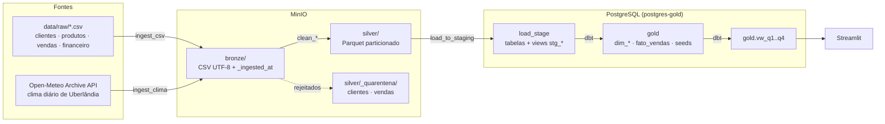
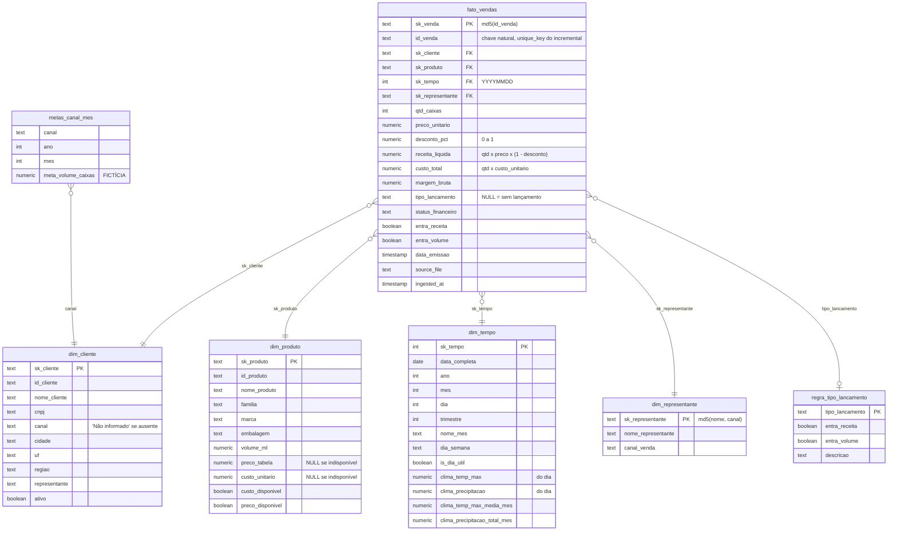

# Arquitetura e modelo de dados

Referência técnica do pipeline: componentes, fluxo entre camadas, orquestração e modelo dimensional.
O panorama geral está no [README](../README.md); as justificativas das decisões, em [`decisoes_tratamento.md`](decisoes_tratamento.md).

## 1. Componentes

| Componente | Imagem / tecnologia | Papel |
|---|---|---|
| Airflow (webserver, scheduler, init) | `apache/airflow:2.9.0-python3.12` + `requirements.txt` (constraints oficial) | Orquestra a DAG `dag_etl_pipeline`. Executa os scripts Python (Bronze, Silver, Load) com `PythonOperator` e o dbt com `DockerOperator`. |
| `postgres-airflow` | `postgres:15` | Banco de metadados do Airflow. |
| MinIO | `bitnamilegacy/minio:2025.7.23-debian-12-r5` | Object storage S3-compatível: buckets `bronze` (CSV bruto) e `silver` (Parquet + quarentena). |
| `postgres-gold` | `postgres:15` | Data warehouse: schemas `load_stage` (carga da Silver + views `stg_*`) e `gold` (dimensões, fato, seeds e views analíticas). |
| dbt (efêmero) | `ghcr.io/dbt-labs/dbt-postgres:1.8.2` | Container criado pelo `DockerOperator` a cada task dbt, na rede `uberlandia-net`, e removido ao final. |
| Streamlit | `python:3.12-slim` (`streamlit/`) | Dashboard que lê as views `gold.vw_q1..vw_q4`. |
| pgAdmin | `dpage/pgadmin4:8.14` | Exploração do warehouse (opcional). |

**`docker.sock`.** É montado no Airflow para o `DockerOperator` criar os containers dbt. Acesso ao socket equivale a root no host, e montá-lo como `:ro` não restringe a API. Isso é aceitável apenas em ambiente local.

## 2. Fluxo de dados



| Camada | Onde | O que acontece |
|---|---|---|
| **Bronze** | `pipeline/bronze/` → `s3://bronze/<tabela>/ingestion_date=<ts>/` | Cópia fiel da origem, lida com o encoding de cada fonte e gravada em UTF-8, com `_ingested_at` e `_source_file`/`_api_source`. |
| **Silver** | `pipeline/silver/` → `s3://silver/<tabela>/` | Tipagem, nulos tratados (`clean_text`), padronização de domínios, deduplicação determinística e validação. Rejeitados vão para `_quarentena/` com `motivo_rejeicao`. |
| **Load** | `pipeline/load/staging.py` → `load_stage.*` | Carga integral da Silver no PostgreSQL. |
| **Gold** | `dbt/` → `gold.*` | Views `stg_*` (cast e renomeação), modelo dimensional, seeds de regras e views analíticas. |

## 3. Orquestração

```
ingest_csv ──► clean_clientes ───┐
           ──► clean_produtos ───┴──► clean_vendas ──┐
           ──► clean_financeiro ─────────────────────┤
ingest_clima ──► clean_clima ────────────────────────┤
                                                     ▼
                                            load_to_staging
                                                     │
 dbt_deps ► dbt_seed ► dbt_run_staging ► dbt_run_gold ► dbt_test_gold ► dbt_run_analytics
```

- `clean_vendas` depende de clientes e produtos porque faz a validação referencial contra os cadastros já limpos.
- `dbt_run_staging` roda a cada execução porque o `DROP TABLE ... CASCADE` da carga remove as views `stg_*` (melhoria prevista no card ARQ-03).
- `dbt_test_gold` bloqueia as views analíticas se algum teste com severidade `error` falhar.

## 4. Modelo dimensional (schema `gold`)



**Notas de modelagem:**
- **Grão da fato:** uma linha por venda (`id_venda`). O lançamento financeiro entra por LEFT JOIN: ~30% das vendas não têm lançamento, então `tipo_lancamento`/`status_financeiro` ficam NULL e as flags ficam `false`.
- **Surrogate keys:** hash MD5 (`dbt_utils.generate_surrogate_key`) da chave natural, exceto `sk_tempo`, que é `YYYYMMDD`. As chaves são estáveis entre execuções.
- **Dimensões:** SCD tipo 1 (estado mais recente). Histórico de clientes (SCD2) está no backlog (MOD-05).
- **`dim_representante`** é derivada das vendas por (nome, canal). A revisão está no backlog (MOD-03).
- **`fato_vendas`** é incremental (`unique_key = id_venda`). O filtro atual por `data_emissao` não reprocessa atualizações tardias (card MOD-01).

## 5. Views analíticas

Todas consideram apenas vendas com `status_financeiro = 'PAGO'` e aplicam as flags do seed `regra_tipo_lancamento`.

| View | Pergunta | Regra aplicada |
|---|---|---|
| `vw_q1_ranking_vendas` | Top 10 produtos por receita em cada região (clientes ativos) | `entra_receita` |
| `vw_q2_volume_vs_meta` | Volume realizado vs. meta por canal | volume com `entra_volume`, receita com `entra_receita`, meta do seed `metas_canal_mes` |
| `vw_q3_tendencia_volume` | Volume diário por produto, dia anterior e média móvel de 7 dias | `entra_volume` |
| `vw_q4_margem_bruta` | Margem bruta por produto | receita de `entra_receita`, custo de `entra_volume` |

## 6. Testes de dados (dbt)

65 testes no total:
- **Staging:** `not_null`/`unique` de chaves; faixas de `qtd_caixas`, `preco_unitario` e `desconto_pct`.
- **Gold:** unicidade e `not_null` das chaves; `relationships` da fato com as dimensões e com o seed de regras; `accepted_values` de status; cobertura de clima.
- **Seeds:** unicidade, domínios e `relationships` de `metas_canal_mes.canal` com `dim_cliente`.
- **Teste singular** `dbt/tests/assert_clima_cobre_dias_com_venda.sql`: todo dia com venda tem clima.
