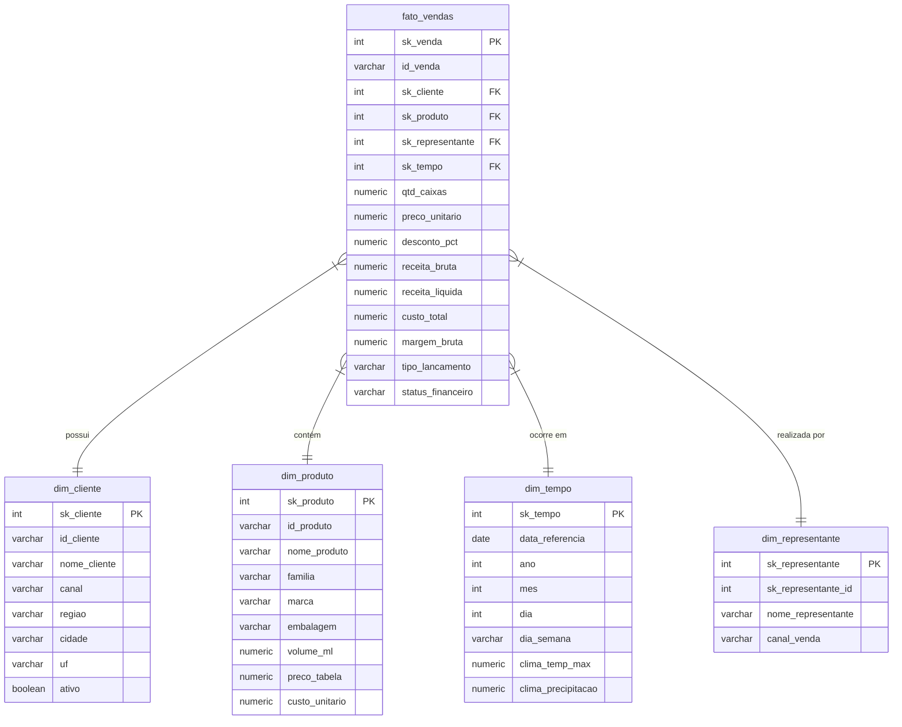
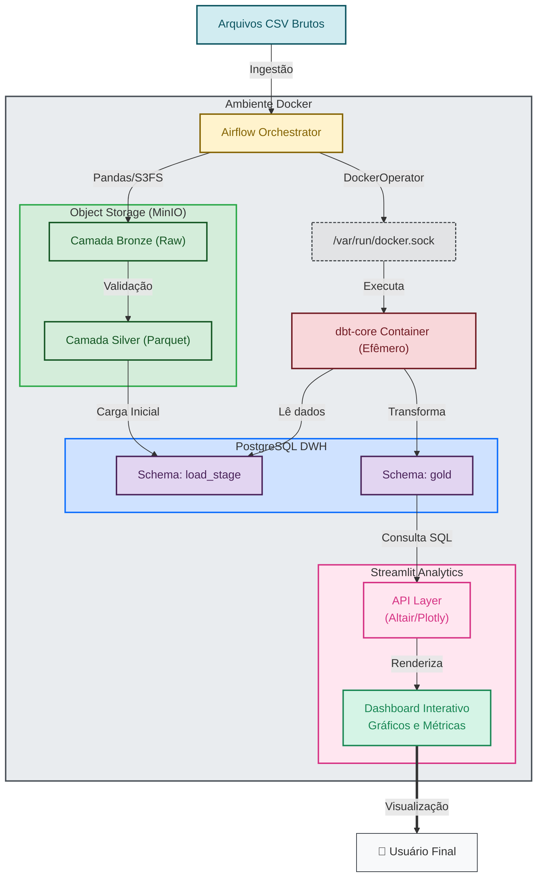

# Documentação da Arquitetura e Pipeline de Dados

## 1. Diagrama Entidade-Relacionamento (Star Schema)

A modelagem dimensional segue o padrão Estrela (Star Schema), construída no schema `gold` do PostgreSQL. Ela centraliza as métricas de negócio na tabela de fatos `fato_vendas`, que se relaciona com as dimensões de contexto.

### Descrição dos Componentes (Modelo de Dados)
- **fato_vendas**: Tabela central que consolida as métricas transacionais de vendas (quantidades, receitas, custos) enriquecida com dados do sistema financeiro (status do lançamento).
- **dim_cliente**: Armazena o cadastro de clientes, dados demográficos e de localização.
- **dim_produto**: Catálogo de produtos (Refreshments), categorizando itens por família, marca e volume.
- **dim_tempo**: Dimensão calendário que inclui métricas de clima agregadas (temperatura e precipitação) para análise de correlação com vendas.
- **dim_representante**: Dimensão para análise de performance da força de vendas baseada no nome e canal de atuação.

---

## 2. Diagrama de Arquitetura e Infraestrutura

A infraestrutura é inteiramente baseada em containers Docker, orquestrada pelo Airflow e utilizando o dbt para as transformações dentro do Data Warehouse.

### Descrição dos Componentes (Infraestrutura)
- **Origem (CSVs)**: Dados transacionais gerados pelos sistemas fonte.
- **Container Airflow (Orquestrador)**: O coração da operação. Executa scripts Python para ingestão (Bronze) e tratamento (Silver). O Airflow possui acesso ao grupo Docker (gid suplementar) para interagir com o daemon host.
- **MinIO**: Armazenamento de objetos simulando S3. Guarda os arquivos brutos particionados (Bronze) e os dados limpos em formato colunar Parquet (Silver).
- **Container Postgres (Data Warehouse)**: Banco de dados relacional hospedando a área de staging (`load_stage`) — alimentada pelo Airflow — e a camada de negócios dimensional (`gold`).
- **Comunicação docker.sock**: Interface crucial montada no container do Airflow. Permite que as tasks `DockerOperator` subam novos containers efêmeros do dbt-core na mesma rede do DWH de forma isolada e segura.
- **Container dbt-core (Transformador)**: Container gerado dinamicamente pelo Airflow apenas durante a execução. Ele lê o código no diretório do projeto, se conecta ao Postgres e materializa as regras de negócio de `load_stage` para `gold`.
